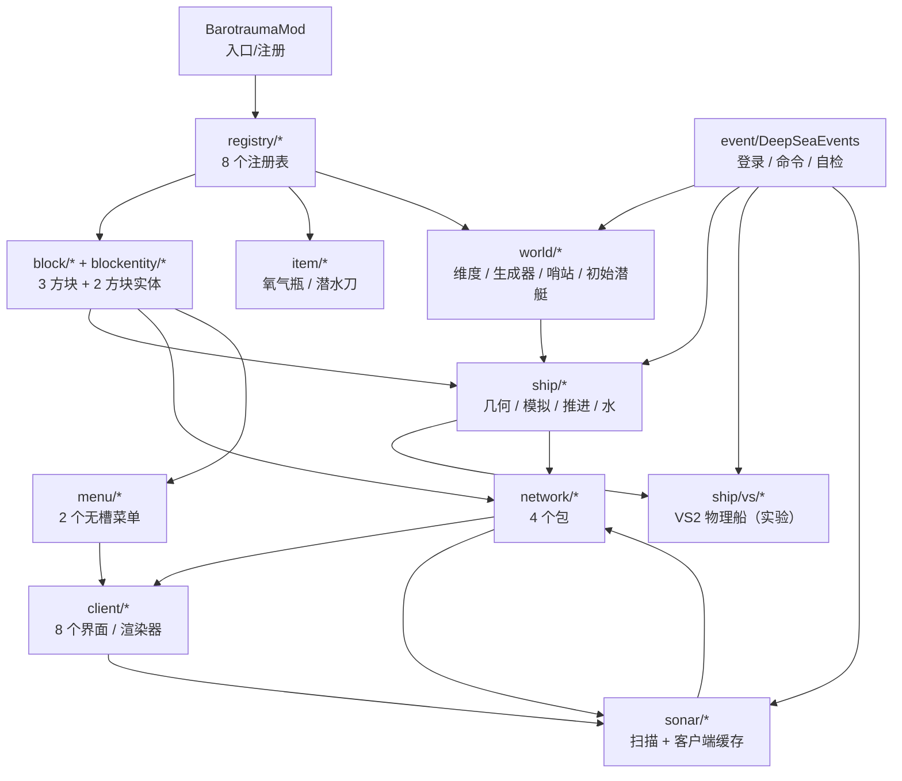
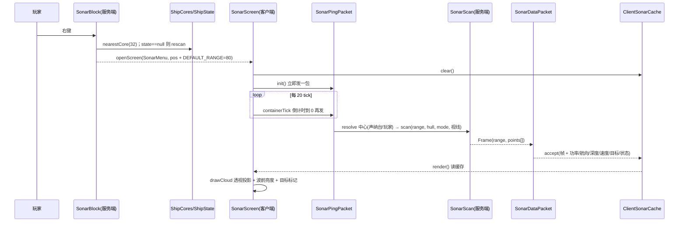
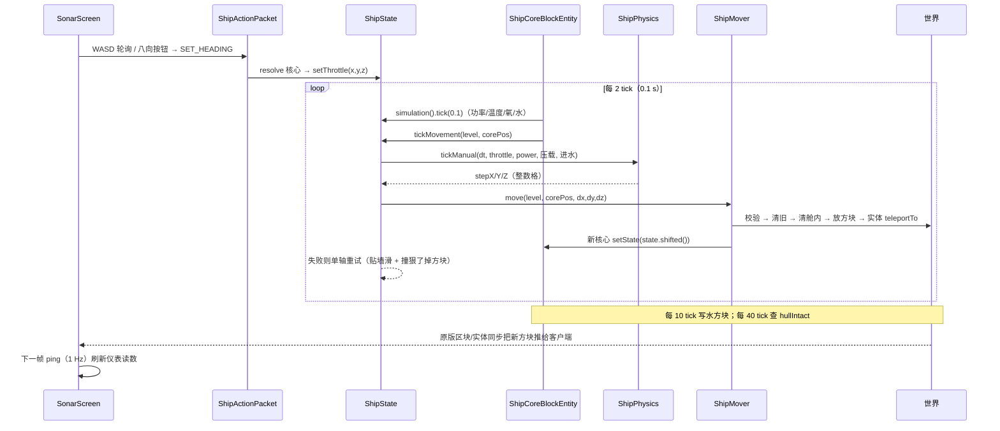

# Barotrauma 模组实现说明

> **适用源码**：`barotrauma/`（MC 1.20.1 / Forge 47.4.0 / ForgeGradle 6.0.54 / Gradle 8.1.1 / JDK 17，见 `gradle.properties:43-51`）
> **覆盖范围**：`src/main/java` 下全部 54 个 Java 类，以及它们直接依赖的资源 JSON、`build.gradle`、`PLAN.md`。
> **引用约定**：`（见 ship/ShipSimulation.java:90）` 里的路径相对 `src/main/java/com/opamb/barotrauma/`，行号是文件真实行号。
> 凡是代码里没有的东西，本文一律写「代码中未体现」，不靠推测补全。

---

## 1. 总览

### 1.1 一句话定位

这是一个把《潜渊症（Barotrauma）》的核心循环搬进 Minecraft 的 Forge 模组：**在一个 1000 米深的实心岩水柱维度里，玩家用「船核心」把一堆方块认成一艘潜艇，靠反应堆供电、制氧机供氧、水泵排水、压载舱控深、引擎推进，用声纳台扫地形并掌舵**。船的移动不是实体，而是**整船方块逐格平移**；水位不是流体模拟，而是**每个舱室一个数字，按需翻译成真实水方块**。

数值参数全部照抄原版 wiki（代码注释里标了来源，见 `ship/ShipSimulation.java:11-20`、`ship/ShipPhysics.java:10-12`），实现上则做了大量 Minecraft 化妥协，这些妥协集中在第 7 节。

### 1.2 模块依赖图



依赖是**单向**的，没有循环：`registry` 只被入口引用；`block`/`blockentity` 依赖 `ship` 与 `menu`；`ship` 不知道 `network` 和 `client` 的存在（`ShipState` 只产出 `Component` 文本）；只有 `network` 的处理器和 `client` 的命令入口把两者粘起来。唯一的例外是 `network/VesselPalettePacket.java:4` 直接 import 了 `client/ClientVesselCache`，靠 `DistExecutor.unsafeRunWhenOn(Dist.CLIENT, ...)` 隔离（见 `network/VesselPalettePacket.java:52-57`），这样服务端加载这个类时不会碰客户端类型。

另外三条「旁路」值得注意：

- `sonar/SonarScan` 是纯服务端逻辑，但 `sonar/ClientSonarCache` 是纯客户端数据（注释明说「纯数据，不放任何客户端专用类型」，见 `sonar/ClientSonarCache.java:3-7`），两者同包不同侧。
- `ship/vs/VsSupport` 故意不引用任何 VS2 类型，只做 `ModList.isLoaded("valkyrienskies")` 判断（见 `ship/vs/VsSupport.java:5-17`），否则没装 VS2 的客户端会在类加载阶段炸。
- `world/StarterSub` 反过来依赖 `blockentity/ShipCoreBlockEntity`，是唯一「世界生成 → 方块实体」的调用（见 `world/StarterSub.java:103-106`）。

### 1.3 一条船的完整生命周期（速查）

| 阶段 | 触发 | 结果 |
| --- | --- | --- |
| 造出来 | `StarterSub.ensure`（首次登录）或玩家手搭 | 船核心方块实体里 `state == null` |
| 认船 | 右键船核心 / 右键声纳台 / 开合舱门 / 破口 | `ShipGeometry.scanShip` 得到舱室划分，缓存进 `ShipState` |
| 跑起来 | `ShipCoreBlockEntity.serverTick` 每 2 tick | 数值模拟 0.1 s + 推进落格 |
| 看得见 | 每 10 tick | 水位 → 真实水方块 |
| 会坏 | 每 40 tick 检查 `hullIntact` | 破洞则重扫，破口舱室变「连海」并灌满 |
| 开起来 | `ShipMover.move` 逐格平移 | 方块换位、实体瞬移、核心状态平移 |
| 收起来（实验） | `/barotrauma ship vs launch` | 方块交给 VS2 刚体，**当前不工作**（见 7.1） |

---

## 2. 改动清单（相对「一个空 Forge 工程」）

判断基准：一个只有 `@Mod` 主类、`mods.toml`、`pack.mcmeta` 的空工程。下面每一行都是新增。

### 2.1 维度与世界生成

| 内容 | 类 / 资源 | 说明 |
| --- | --- | --- |
| 深海维度 | `data/barotrauma/dimension/the_deep.json` | 引用 `barotrauma:deep_sea` 生成器 + 固定生物群系 `barotrauma:abyss` |
| 维度类型 | `data/barotrauma/dimension_type/the_deep.json` | `height=1024`、`min_y=-1008`、`has_ceiling=true`、`has_skylight=false`、`ambient_light=0.1` |
| 生物群系 | `data/barotrauma/worldgen/biome/abyss.json` | 无特性、无生成、无雕刻器，只定义雾/水色 |
| 坐标常量 | `world/ModDimensions.java` | 水面 -1、水底 -1000、海床 -1001、哨站中心 y=-150 |
| 区块生成器 | `world/DeepSeaChunkGenerator.java` | 注册名 `barotrauma:deep_sea`（`registry/ModChunkGenerators.java:23-24`） |
| 噪声库 | `world/DeepSeaNoise.java` | 种子化 value noise + fbm，无 `RandomSource` |
| 主干道/竖井 | `world/TrunkNetwork.java` | 抖动网格图哈希出竖井 |
| 新手哨站 | `world/OutpostBuilder.java` | 40×21×24 气密盒子 + 椭球水池 |
| 初始潜艇 | `world/StarterSub.java` | 9×5×15 小艇，含 8 台设备 |
| VS2 维度参数 | `data/valkyrienskies/vs_dimension_parameters/the_deep.json` | 重力 `-10`，与 `VsThruster.GRAVITY` 对齐 |

### 2.2 方块与物品

| 内容 | 类 | 说明 |
| --- | --- | --- |
| 潜艇装甲板 | `registry/ModBlocks.java:25-30` | 硬度 25 / 抗爆 1200，需要镐 |
| 耐压舷窗 / 舱门 / 气闸门 | `registry/ModShipBlocks.java:26-37` | 门是 `ShipDoorBlock`，带 `open` 状态 |
| 七台机器 + 舵 + 核心 | `registry/ModShipBlocks.java:40-64` | 全部 10 硬度 / 300 抗爆 / `noOcclusion` |
| 站点装甲 | `registry/ModShipBlocks.java:66-72` | 40 硬度，**故意不算船体**，防止把空间站认成船 |
| 氧气瓶 / 潜水刀 | `item/OxygenTankItem.java`、`item/DivingKnifeItem.java` | 15 个物品，见 `registry/ModItems.java:24-47` |
| 创造页 | `registry/ModCreativeTabs.java:20-41` | 15 个条目，图标是氧气瓶 |
| 两个方块实体类型 | `registry/ModBlockEntities.java:20-26` | `sonar`、`ship_core` |

### 2.3 实体

| 内容 | 类 | 说明 |
| --- | --- | --- |
| 结构体船实体 | `entity/VesselEntity.java` + `registry/ModEntities.java:21-25` | `MobCategory.MISC`、1×1 判定箱、`noPhysics = true`（`entity/VesselEntity.java:39`） |
| 调色板同步包 | `network/VesselPalettePacket.java` | 实体进入玩家视野时下发整船方块列表（`entity/VesselEntity.java:133-139`） |
| 实体渲染器 | `client/VesselRenderer.java` | 按调色板逐方块 `renderSingleBlock` |

**注意**：这条「结构体船」链路目前**没有任何调用方**——`world`、`event`、`ship` 里都没有 `ShipAssembler.launch` 的调用点（全仓搜索只命中定义本身）。它是 M4 原型留下的死代码，见 7.3。

### 2.4 船舶系统（`ship` 包）

| 内容 | 类 | 说明 |
| --- | --- | --- |
| 几何识别与分舱 | `ship/ShipGeometry.java` | 连通分量找船 → 包围盒 BFS 分舱 → 边界判定破口 |
| 机器统计 | `ship/MachineCount.java` | 8 个计数的 record |
| 船状态 | `ship/ShipState.java` | 几何 + 模拟 + 物理 + 油门 + 自动驾驶 + 水位写回 |
| 数值模拟 | `ship/ShipSimulation.java` | 功率/温度/氧气/水/压载/气闸，303 行核心 |
| 水位 → 水方块 | `ship/ShipWater.java` | 每舱一个数字，按 Y 排序从底往上铺 |
| 整船平移 | `ship/ShipMover.java` | 剪切 → 校验 → 粘贴 + 实体瞬移 |
| 连续运动模型 | `ship/ShipPhysics.java` | 速度/惯性/浮力，攒够整格才落格 |
| 装配/展开（结构体） | `ship/ShipAssembler.java` | 方块 ↔ `VesselEntity`，当前无人调用 |
| 核心查找与重扫 | `ship/ShipCores.java` | 按区块方块实体表找最近核心 |
| VS2 桥接（4 类） | `ship/vs/*` | 反射 + 附件注册 + 物理回调推力 |

### 2.5 声纳（`sonar` + `client`）

| 内容 | 类 | 说明 |
| --- | --- | --- |
| 服务端点云扫描 | `sonar/SonarScan.java` | 三态网格、表面判定、9 位打包、三种模式 |
| 客户端缓存 | `sonar/ClientSonarCache.java` | 静态字段存帧 + 仪表读数 |
| 请求包 | `network/SonarPingPacket.java` | C→S，带射程/模式/视线方向 |
| 回包 | `network/SonarDataPacket.java` | S→C，点云 + 16 个字段 |
| 全息渲染 | `client/SonarRenderer.java` | 方块实体上方缩微体素云 |
| 界面 | `client/SonarScreen.java` | 975 行，左示波器 + 右舵盘 |
| 声纳台方块 | `block/SonarBlock.java` + `blockentity/SonarBlockEntity.java` | 右键开界面；客户端自己每 20 tick 扫一次 40 格 |

### 2.6 网络协议

| 内容 | 类 | 说明 |
| --- | --- | --- |
| 通道 | `network/ModNetwork.java:13-16` | `barotrauma:main`，协议号 `"1"` |
| 包 0 | `ShipActionPacket` | C→S，13 种船控指令 |
| 包 1 | `VesselPalettePacket` | S→C，整船方块调色板 |
| 包 2 | `SonarPingPacket` | C→S，请求一次扫描 |
| 包 3 | `SonarDataPacket` | S→C，一帧声纳数据 |

### 2.7 界面与渲染

| 内容 | 类 | 说明 |
| --- | --- | --- |
| 船控面板 | `menu/ShipConsoleMenu.java` + `client/ShipConsoleScreen.java` | 8 个按钮：泵进/出、反应堆 ±10%、气闸抽干/注水、推进/停车 |
| 声纳/操舵台 | `menu/SonarMenu.java` + `client/SonarScreen.java` | 无物品槽，`stillValid` 只比距离（`menu/SonarMenu.java:41-44`） |
| 深度 HUD | `client/DepthOverlay.java` | 只在深海维度显示，1 格 = 1 米 |
| 粒子抑制 | `client/DeepSeaParticles.java` | 深海维度里 `underwater`/`bubble` 返回 null |
| 客户端注册 | `client/ClientSetup.java` | 玻璃 cutout 层、两个菜单界面、两个渲染器 |
| 全息体素 | `client/SonarRenderer.java` | `debugQuads()` + `lines()`，无贴图 |
| 船体调色板缓存 | `client/ClientVesselCache.java` | `Map<Integer, Palette>` |

### 2.8 事件与命令

| 内容 | 类 | 说明 |
| --- | --- | --- |
| 首次登录送哨站 | `event/DeepSeaEvents.java:61-75` | `PersistentData` 标记 `barotrauma_visited_deep` |
| 出生点/重生点 | `event/DeepSeaEvents.java:77-94` | 传送到 (0.5, -158, 0.5) 并 `setRespawnPosition` |
| `/barotrauma` 命令树 | `event/DeepSeaEvents.java:97-240` | 4 个顶层 + `ship` 下 12 组，详见 4.8 |
| 服务端 tick | `event/DeepSeaEvents.java:944-974` | VS2 补挂推进器 + 自检倒计时 |
| 自检入口 | `event/DeepSeaEvents.java:810-940` | `.smoketest` 标记文件 |

---

## 3. 逐个类的职责表

> `关键方法` 列只列对外/对上层有意义的入口，构造器与 getter 略。行号取方法声明行。

### 3.1 根包与 `registry`

| 类 | 包 | 职责 | 关键方法 |
| --- | --- | --- | --- |
| `BarotraumaMod` | `com.opamb.barotrauma` | 模组入口；在构造器里把 8 个 `DeferredRegister` 和网络频道挂到 mod 总线 | 构造器 `:36`（注册顺序 `:39-47`） |
| `ModBlocks` | `registry` | 只注册 `submarine_plating` 一个基础方块 | `register` `:35` |
| `ModShipBlocks` | `registry` | 12 个船用方块 + `Machine` 枚举 + 三个判定函数 | `machineOf` `:82`、`isSolidForShip` `:105`、`isShipBlock` `:113` |
| `ModItems` | `registry` | 2 个物品 + 13 个 `BlockItem` | `blockItem` `:53` |
| `ModCreativeTabs` | `registry` | 单个创造页 `main`，硬编码 15 个条目 | 静态初始化 `:20-41` |
| `ModBlockEntities` | `registry` | `sonar` / `ship_core` 两个 BE 类型 | `:20-26` |
| `ModEntities` | `registry` | `vessel` 实体类型，`clientTrackingRange(10)` | `:21-25` |
| `ModMenus` | `registry` | `ship_console` / `sonar` 两个菜单类型 | `:20-24` |
| `ModChunkGenerators` | `registry` | 把 `DeepSeaChunkGenerator.CODEC` 注册成 `deep_sea` | `:23-24` |

### 3.2 `block`

| 类 | 包 | 职责 | 关键方法 |
| --- | --- | --- | --- |
| `ShipCoreBlock` | `block` | 船核心方块；右键开船控面板，已有状态则复用（避免重扫重置温度和水量） | `use` `:51`、`getTicker` `:41` |
| `SonarBlock` | `block` | 声纳台；右键先找 32 格内的核心并补扫，再开界面 | `use` `:56`、`getTicker` `:49` |
| `ShipDoorBlock` | `block` | 可开合舱门；关门实心挡水，开门只剩 4/16 高，几何上算连通 | `use` `:52`、`getCollisionShape` `:47` |

### 3.3 `blockentity`

| 类 | 包 | 职责 | 关键方法 |
| --- | --- | --- | --- |
| `ShipCoreBlockEntity` | `blockentity` | 持有 `ShipState`；服务端每 2 tick 推进模拟与推进，每 10 tick 写水，每 40 tick 查破口 | `serverTick` `:34`、`rescan` `:74`、`setState` `:69` |
| `SonarBlockEntity` | `blockentity` | 客户端专用的简化扫描器：半径 40、步长 4，20 tick 一次，2400 点上限 | `clientTick` `:38`、`scan` `:47` |

### 3.4 `ship`

| 类 | 包 | 职责 | 关键方法 |
| --- | --- | --- | --- |
| `ShipGeometry` | `ship` | 纯逻辑几何：找连通船体、算包围盒、BFS 分舱、判定破口 | `scanShip` `:123`、`collectHull` `:175`、`Result.shifted` `:89` |
| `ShipState` | `ship` | 一艘船的运行时状态：几何 + 机器 + 模拟 + 物理 + 油门 + 自动驾驶 + 水位写回 | `tickMovement` `:273`、`shifted` `:253`、`collectBlocks` `:72`、`liveReport` `:396` |
| `ShipSimulation` | `ship` | 10 Hz 定步长数值模拟：功率、温度、氧气、水、压载、气闸 | `tick` `:89`、`report` `:254`、`requestDrain` `:160` |
| `ShipPhysics` | `ship` | 连续速度/惯性/浮力，量化成整格位移 | `tickManual` `:41`、`tickAuto` `:55`、`consume` `:91`、`blocked` `:102` |
| `ShipMover` | `ship` | 整船方块平移：碰撞校验 → 剪切 → 粘贴 → 实体瞬移 → 状态平移 | `move` `:33` |
| `ShipWater` | `ship` | 把每舱水量翻译成真实水方块，按 Y 从底往上铺 | `apply` `:52` |
| `ShipCores` | `ship` | 核心查找（按区块 BE 表）、半径内批量重扫、坐标失效回退 | `nearestCore` `:41`、`rescanNear` `:21`、`resolve` `:73` |
| `ShipAssembler` | `ship` | 方块 ↔ `VesselEntity`（结构体船原型） | `launch` `:30`、`dock` `:67` |
| `MachineCount` | `ship` | 8 种机器的计数 record + 中文描述 | `describe` `:15` |

### 3.5 `ship/vs`

| 类 | 包 | 职责 | 关键方法 |
| --- | --- | --- | --- |
| `VsSupport` | `ship/vs` | 只回答「装没装 VS2」，不引用任何 VS2 类型 | `available` `:15` |
| `VsBridge` | `ship/vs` | VS2 薄封装：装配/拆船/读变换/挂附件/诊断 | `assemble` `:31`、`dock` `:37`、`attach` `:94`、`loaded` `:63` |
| `VsPilot` | `ship/vs` | 物理船运行时：装船、补挂推进器、拆回、状态字符串、自检 | `launch` `:82`、`tick` `:45`、`dock` `:133`、`status` `:172` |
| `VsThruster` | `ship/vs` | VS2 物理回调里施加力（按加速度给，自补浮力） | `physTick` `:117` |

### 3.6 `sonar`

| 类 | 包 | 职责 | 关键方法 |
| --- | --- | --- | --- |
| `SonarScan` | `sonar` | 球采样 → 三态网格 → 表面提取 → 29 位打包；三种模式 | `scan` `:93`、`strideFor` `:83`、`pack` `:240` |
| `ClientSonarCache` | `sonar` | 客户端静态缓存：帧、功率、航向、模式、深度、速度、自动驾驶、目标 | `accept` `:30`、`clear` `:130` |

### 3.7 `network`

| 类 | 包 | 职责 | 关键方法 |
| --- | --- | --- | --- |
| `ModNetwork` | `network` | 单频道 + 4 个包注册 + 两个发送便捷方法 | `register` `:23`、`sendToPlayer` `:34` |
| `ShipActionPacket` | `network` | C→S 船控指令；13 个 action 常量，`a/b/c` 复用为方向或坐标 | `handle` `:62` |
| `SonarPingPacket` | `network` | C→S 请求扫描；服务端完成全部扫描与组包 | `handle` `:47`、`passiveRange` `:125` |
| `SonarDataPacket` | `network` | S→C 点云 + 仪表读数 | `encode` `:20`、`handle` `:67` |
| `VesselPalettePacket` | `network` | S→C 整船方块调色板（NBT 序列化每个方块状态） | `encode` `:25`、`handle` `:52` |

### 3.8 `client`

| 类 | 包 | 职责 | 关键方法 |
| --- | --- | --- | --- |
| `SonarScreen` | `client` | 975 行主界面：左圆形示波器（透视投影点云 + 波前 + 目标标记 + 方位字），右舵盘（八向/升降/推力/自动） | `render` `:216`、`drawCloud` `:304`、`markTargetAt` `:832`、`pollKeys` `:130` |
| `SonarRenderer` | `client` | 声纳台上方的 3D 全息：缩微体素 + 两圈距离环 + 旋转扫描线 | `render` `:34` |
| `ShipConsoleScreen` | `client` | 240×190 面板，8 个按钮，底部按 `｜` 拆行显示状态 | `init` `:28`、`render` `:56` |
| `DepthOverlay` | `client` | `RenderGuiEvent.Post` 里左上角画「深度 N m」 | `onRenderGui` `:24` |
| `DeepSeaParticles` | `client` | 换掉两个粒子 Provider，深海维度返回 null | `onRegisterProviders` `:29` |
| `ClientSetup` | `client` | 客户端初始化：渲染层、菜单界面、方块实体/实体渲染器 | `onClientSetup` `:24`、`onRegisterRenderers` `:35` |
| `ClientVesselCache` | `client` | 按实体 id 缓存调色板 | `put` `:23`、`get` `:28` |
| `VesselRenderer` | `client` | 逐方块渲染结构体船 | `render` `:29` |

### 3.9 `world`

| 类 | 包 | 职责 | 关键方法 |
| --- | --- | --- | --- |
| `ModDimensions` | `world` | 维度 key、y 轴骨架常量、哨站坐标、格↔米换算 | `toMeters` `:42` |
| `DeepSeaNoise` | `world` | 整数哈希 value noise（3D/2D）+ fbm | `noise3` `:42`、`fbm3` `:73` |
| `DeepSeaChunkGenerator` | `world` | 一次写满整个区块：冰盖/石头/深板岩底 → 分层海域 → 主干道 → 哨站 → 高度图 | `fillFromNoise` `:92`、`generate` `:101` |
| `TrunkNetwork` | `world` | 抖动网格图的竖井 + 写死的哨站竖井 | `carveInto` `:61` |
| `OutpostBuilder` | `world` | 按坐标算方块的气密哨站 + 外部椭球水池 | `build` `:71`、`carveCavern` `:54` |
| `StarterSub` | `world` | 就地搭建 9×5×15 初始潜艇并扫描一次 | `ensure` `:47`、`corePos` `:34` |

### 3.10 `menu` / `item` / `entity` / `event`

| 类 | 包 | 职责 | 关键方法 |
| --- | --- | --- | --- |
| `ShipConsoleMenu` | `menu` | 无物品槽；`stillValid` 只要求核心 BE 还在 | `stillValid` `:39` |
| `SonarMenu` | `menu` | 无物品槽；`stillValid` 只比 8 格距离（船开走后绝对坐标会变） | `stillValid` `:41` |
| `OxygenTankItem` | `item` | 右键补满氧气并扣 1 点耐久；氧气满时不消耗 | `use` `:31` |
| `DivingKnifeItem` | `item` | 纯 `SwordItem` 子类 + tooltip | `appendHoverText` `:26` |
| `VesselEntity` | `entity` | 把整船方块存进 NBT，自己按 `motion` 漂移，9 个采样点做阻挡 | `tick` `:88`、`deploy` `:188`、`canOccupy` `:112` |
| `DeepSeaEvents` | `event` | 4 个 Forge 事件 + 整套 `/barotrauma` 命令 + 三个自检场景 | `onLogin` `:61`、`onRegisterCommands` `:97`、`onServerStarted` `:810`、`shipSelfTest` `:502` |

---

## 4. 核心机制

### 4.1 船舶装配与几何

#### 4.1.1 找船：半径立方体内的**最近连通分量**

`ShipCoreBlockEntity.rescan` 传 `RADIUS = 24`（`blockentity/ShipCoreBlockEntity.java:23`），`ShipGeometry.collectHull` 在 `(2·24+1)³ = 117,649` 个坐标上逐个问 `isShipBlock`（见 `ship/ShipGeometry.java:178-188`）。

「哪些方块算船体」由 `ModShipBlocks.isShipBlock` 决定：12 种船用方块 + 潜艇装甲板；**船核心自身和站点装甲不算**（`registry/ModShipBlocks.java:113-126`，注释在 `:66` 解释为什么排除站点装甲）。

然后对这批方块做 6 邻接 BFS 求连通分量，**取「离核心最近」的那一块**，不是最大的（`ship/ShipGeometry.java:174-219`，比较量是 `pos.distSqr(core)` 的最小值 `:206`、`:213-216`）。同文件里的 `largestComponent`（`:221-245`）是死代码，而且类注释 `:18-19` 写的是「取最大的那块」——**注释与实现矛盾**，见 7.4。

得到连通块后取包围盒（`:130-139`），作为分舱的唯一搜索空间。

#### 4.1.2 分舱：包围盒内 BFS + 边界触海判定

```
对包围盒里每个未访问且非实心的格子做 flood：
  碰到包围盒 6 个面中的任意一个 → touchesBoundary = true
  6 邻接继续扩散，最多 30,000 格（MAX_CELLS_PER_FILL，:112）
```

- 未触边 = 封闭舱室，进 `compartments`；触边 = 连到外海，进 `openPockets`（`:156-166`）。
- `Probe.isSolid` 用的是 `ModShipBlocks.isSolidForShip`：**开着的门不算墙**（`registry/ModShipBlocks.java:105-110`），所以开门会让两个舱室合并。
- 船核心自己那一格被强制当成非实心，否则洪水填充从起点就走不动（`blockentity/ShipCoreBlockEntity.java:78-81`）——这条注释是踩过坑留下的。
- `Compartment.waterBlocks` 是**扫描瞬间**数出来的水格数（`:262-264`），之后由 `ShipSimulation` 接管，不再重新数。

`Result.sealed()` 就是 `openPockets.isEmpty()`（`:78-80`），被面板和自检直接使用。

#### 4.1.3 破口判定与重扫

两条独立路径：

1. **主动**：`ShipState.hullIntact` 遍历 `geometry.hull()`，任一格不再是 `isShipBlock` 就返回 false（`ship/ShipState.java:56-63`）。`ShipCoreBlockEntity` 每 40 tick 调一次，false 就重扫（`blockentity/ShipCoreBlockEntity.java:62-64`）。
2. **被动**：开合门时 `ShipCores.rescanNear(level, pos, 32)` 把 32 格内的核心全部重扫（`block/ShipDoorBlock.java:60`）。注意这是 `65³ = 274,625` 次 `getBlockEntity`（`ship/ShipCores.java:23-31`），是个可观测的开销，见 7.5。

重扫会把破口舱室重新分类为 `openPockets`，而 `ShipWater` 对 `openPockets` 一律按满水处理（`ship/ShipWater.java:56-57`），于是「破洞 → 那个舱室灌满」是几何自动得出的，没有额外的洪水逻辑。

#### 4.1.4 装配/展开（结构体船原型）

`ShipAssembler.launch`：先 `rescan`，取 `geometry.hull()` + 核心位置，把状态存成 `List<BlockState>` + 相对 `bounds.min` 的偏移，原位置填水（`Blocks.WATER`，flag 2），在 `origin` 生成 `VesselEntity` 并 `setPalette`（`ship/ShipAssembler.java:30-64`）。`dock` 调 `vessel.deploy()` 逐格写回，再从 palette 里找 `SHIP_CORE` 算出核心坐标并重扫（`:67-83`）。

两个已知缺陷：`launch` 用的是 `geometry.hull()` 而非 `ShipState.collectBlocks`（`:36`），与 10.32 的修法不一致；且它没有任何调用方（见 7.3）。

#### 4.1.5 核心查找

`ShipCores.nearestCore` 不逐格查方块，而是翻**已加载区块的方块实体表**：区块半径 `ceil(maxDistance/16)`，用 `getChunkSource().getChunk(x, z, FULL, false)`（`false` = 不加载）遍历 `getBlockEntitiesPos()`（`ship/ShipCores.java:41-66`）。32 格 → 5×5 = 25 个区块。

`resolve(level, hint, fallback)` 先用提示坐标，命中不了再退回 `nearestCore(..., 32)`（`:73-78`）。船在开动时核心坐标一直在变，所以 `ShipActionPacket` / `SonarPingPacket` 都走这条回退（`network/ShipActionPacket.java:71`、`network/SonarPingPacket.java:59`）。

### 4.2 数值模拟 `ShipSimulation`

#### 4.2.1 步长与状态量

- 步长固定 **0.1 s**，由调用方传：`ShipCoreBlockEntity` 每 2 tick 调一次（`blockentity/ShipCoreBlockEntity.java:40-45`），2 tick = 0.1 s，所以模拟是实时的 10 Hz。
- 单位：**1 格舱容 = 100 单位**（`ship/ShipSimulation.java:24`）。600/s 的水泵抽 273 格（27,300 单位）约 45 秒，这是代码注释给的换算理由（`:8-11`）。
- 每舱三个数组：`volumes[]`（格）、`water[]`（单位）、`oxygen[]`（单位）。初值：水 = 扫描时的水格数×100，氧 = 满舱×100（`:72-86`）。
- 标量状态：`temperature = 3000`、`fission = turbine = 0.5`、`fuelRods = 1`、`ballast = 0`、`pumpOut = true`、气闸 3 个字段（`:46-52`、`:68-70`）。

#### 4.2.2 功率

```
output = 反应堆数 × 5000 × turbine        （:90）
demand = 泵×300 + 制氧×300 + 声纳×100
       + (气闸动作中 ? 300 : 0) + 引擎×2000×0.5   （:91-95）
ratio  = demand ≤ 0 ? 1 : min(1, output/demand)   （:96）
```

三个要点：

1. **`fission` 不参与功率**，只有 `turbine` 决定 output；拉高裂变率只会加热（对比 `:90` 与 `:102`）。
2. 引擎按 **2000 kW 的一半**计需求（`:95`），代码里没写为什么减半。
3. `ratio` 只用来缩放制氧、水泵、气闸的速率（`:114`、`:131`、`:145`、`:151`），**不影响船的推进速度**——`ShipPhysics` 只看功率百分比（见 4.3.1）。也就是说缺电时船照样满速，这是一个实现与「电推潜艇」设定的偏差。

#### 4.2.3 温度与熔毁

```
heatIn  = fission × 80 × fuelRods(1) × 2 × 反应堆数      （:102）
heatOut = turbine × 5000 × 0.02 × 反应堆数               （:103）
T += (heatIn − heatOut) × dt                            （:104）
T −= max(0, T − 2000) × 0.0015 × dt                     （:105）
T  clamp 到 [0, 12000]                                  （:106）
```

阈值：**过热 6482 °C、熔毁 7965 °C**（`:38-39`），报告里只是两个布尔（`:258`）。

按公式推算（1 座反应堆、`fission = turbine = 0.5`）：`heatIn = 80`、`heatOut = 50`，净 +30 °C/s，散热项 `(T−2000)×0.0015` 在 3000 °C 时只有 1.5 °C/s。解 `dT/dt = 33 − 0.0015T` 得 `T(t) = 22000 − 19000·e^(−0.0015t)`，即**默认参数下约 135 s 到过热、约 202 s 到熔毁**。而熔毁在代码里没有任何后果——只把面板文字变成红色（`ship/ShipState.java:410-411`、`:424-425`），见 7.6。

#### 4.2.4 耗氧

```
produced = 制氧机数 × 700 × ratio × dt                  （:114）
按 volumes[i]/totalVolume 比例分给每个舱室               （:115-117）
oxygen[最大舱] -= 700 × dt                              （:119-128）
```

`oxygenPercent()` = 总氧量 / 总舱容（`:240-248`），所以初始就是 100%。消耗**只扣最大的那一个舱室**，代码注释直接写明「一个人，从最大的舱室扣——M3 先不追踪玩家位置」（`:119`）。没有「多船员」「哪个舱有玩家」的模型。

#### 4.2.5 水泵与压载

```
moved = 泵数 × 600 × ratio × dt
pumpOut = true  → 按舱室下标顺序依次抽，抽到 moved 用完   （:132-137）
pumpOut = false → 灌进压载舱，上限 = 压载舱数 × 600        （:138-141）
```

两个不对称点：抽水是**按数组下标顺序**抽（不是按水量比例），所以 1 号舱总是先干；注水（`PUMP_IN`）灌的是**压载舱**，不是舱室，代码里没有「往舱室灌水」的泵路径——舱室进水只能靠 `flood(index, units)` 这个测试/事件入口（`:191-195`）。

`ballastPercent()` = `ballast / (压载舱数×600)`（`:250-252`），供 `ShipPhysics` 算下沉（见 4.3.1）。

#### 4.2.6 气闸

容积**写死** 2700 单位（= 27 格），与船上真实的气闸舱室无关（`:59`）。初始状态是**满水**（`:69`），所以第一次 `requestDrain` 能成功。

- `requestDrain` 要求：有气闸、阶段为 `CLOSED`、水 > 0（`:160-166`）。
- `requestFlood` 要求：有气闸、阶段为 `CLOSED`、水 < 2700（`:169-176`）。
- 每 tick 以 `600 × ratio × dt` 变化，到端点自动回 `CLOSED` 并 `airlockCycles++`（`:144-156`）。
- 气闸动作期间功率需求 +300 kW（`:94`）。

气闸阶段**不影响开门判定**，代码里没有「抽干才能开外门」的联动，见 7.7。

#### 4.2.7 参数总表（全部来自代码常量）

| 量 | 值 | 位置 |
| --- | --- | --- |
| 反应堆最大功率 | 5000 kW | `:26` |
| 制氧机 | 700 氧/s，300 kW | `:27`、`:31` |
| 乘员耗氧 | 700/s | `:28` |
| 水泵 | 600/s，300 kW | `:29-30` |
| 声纳台 | 100 kW | `:33` |
| 引擎 | 2000 kW（按 0.5 计需求） | `:35`、`:95` |
| 压载舱容量 | 600/个 | `:36` |
| 过热 / 熔毁 | 6482 / 7965 °C | `:38-39` |
| 气闸容积/功率/速率 | 2700 单位 / 300 kW / 600 每秒 | `:59-61` |
| 燃料棒热势 | 80 | `:102` |

### 4.3 推进与物理

#### 4.3.1 `ShipPhysics`：连续量，整格落

目标速度由油门和功率算，然后用一阶惯性逼近（指数平滑，与帧率无关）：

```
kh = 1 − exp(−dt / 0.9)     水平时间常数 0.9 s      （:21、:60）
kv = 1 − exp(−dt / 1.4)     垂直时间常数 1.4 s      （:23、:61）
v  += (目标v − v) × k
f  += v × dt                余量累积                 （:66-68）
```

- 满推力水平 6 格/秒、垂直 2.5 格/秒（`:17-19`）。
- 手动模式把八向推力归一化（斜着不加速），再叠加下沉：`sink = −0.8 × heavy − 1.5 × flooded`，其中 `heavy = max(0, 压载−0.5) × 2`，最后夹到 `−2.0`（`:41-52`）。即**压载过半才开始吃重量，满舱 = −0.8 格/秒，进水按比例最多再 −1.5**。
- 落格：`stepX/Y/Z` 直接 `(int) fx` 截断（`:78-88`）。注意注释写「负值向下」，但 Java 的 `(int)` 是**向零截断**，−0.6 会变成 0——这是注释与语言语义的偏差，见 7.4。
- 撞墙只清一轴：`blocked(axis)` 把该轴速度和余量清零，另两轴继续（`:102-113`），所以能贴墙滑行。

#### 4.3.2 `ShipMover`：剪切 → 校验 → 粘贴

顺序严格（`ship/ShipMover.java:33-111`）：

1. 取 `state.collectBlocks(level)`（包围盒 ±1 内所有 `isShipBlock` 方块，**不是** `hull()`），再把核心位置硬加进去（`:41-46`）。这一步是 10.32 的修复点：门/玻璃/独立机器不与主船体连通时，用 `hull()` 会把它们留在原地（`:39-40` 的注释就是这么写的）。
2. 目标位检查：船自己的格子跳过，其余必须空气或流体，否则整体拒绝（`:49-58`）。
3. 快照方块状态，收集「舱内格子」= 所有 `compartments` + `openPockets` 的 cells（`:61-71`）。
4. 判断船外是水还是空气：采样 `(minX−1, 平均Y, 平均Z)` 一格的水流体（`:73-77`），据此决定旧位置填水还是填空气。
5. 清旧位置 → 清新位置舱内 → 放方块（`:80-89`）。
6. 把包围盒内**所有实体**一起 `teleportTo(+dx,+dy,+dz)`（`:92-96`）。
7. 新核心 `setState(state.shifted(dx,dy,dz))`，免重扫；找不到就退回逐个重扫（`:99-109`）。

#### 4.3.3 碰撞、滑行与损伤

`ShipState.applyStep` 先试整步；失败则拆成 X/Y/Z 三个单轴依次试（`ship/ShipState.java:296-314`）。单轴失败时：

- 记 `hitSpeed = |该轴速度|`，调 `physics.blocked(axis)`；
- **`hitSpeed > 1.0` 才掉方块**，否则只停车（`:327-331`）——注释解释：慢慢沉到海床不该把船底啃穿；
- 撞上的轴推力归零，防止「一直顶着墙啃自己」（`:333-339`）；
- 自动驾驶顶墙就放弃目标（`:340-343`）。
- `damageFront` 在 `geometry.hull()` 里挑**与运动方向点积最大**的一格（即最靠前的方块）设成空气（`:348-364`）。它不检查这一格是否真的在碰撞面上，是个粗糙近似。

#### 4.3.4 `ShipWater`：水位 → 真实水方块

每个舱室的 cells 先按 `(Y, X, Z)` 升序排好（`ship/ShipWater.java:42-49`），于是「从底往上填」就是按下标顺序填。

```
filled = openToSea ? volume : floor(waterUnits(index) / 100)   （:56-61）
夹到 [0, volume]
前 filled 格：空气 → 水；其余格：水 → 空气                     （:67-78）
```

两个细节：只改「空气 ↔ 水」，机器/装甲方块不会被覆盖；`openPockets`（破口连海的空腔）永远按满水画。调用频率是每 10 tick 一次（`blockentity/ShipCoreBlockEntity.java:58-60`），且**物理船激活时跳过**（`:55-58`，注释解释了不跳就会灌到船原来的位置）。

### 4.4 声纳

#### 4.4.1 `SonarScan`：球采样 + 三态网格 + 表面提取

1. **步长自适应**：`stride = max(2, round(clamp(range,16,160)/12))`（`sonar/SonarScan.java:83-85`）。射程 16→2、80→7、160→13，`base = (r/stride)*stride`，网格边长 `n = 2*(base/stride)+1`，于是查询格数分别约 4,913 / 12,167 / 15,625，基本恒定。
2. **三态网格**：`byte[n³]`，`UNKNOWN=0 / SOLID=1 / EMPTY=2`（`:218-220`）。默认 0，即「不知道」。这是 10.31 的修复点：旧版用 `boolean` 且默认 `true`（球外当实心），导致球边界一圈全被判成表面，屏幕上出现一个完美球壳（`:118-121` 的注释）。
3. **不加载区块**：列级先判 `level.hasChunk((cx+x)>>4, (cz+z)>>4)`，没加载就保持 `UNKNOWN`（`:133-135`）。注释给的代价是「一次 48 m 扫描会硬拉 49 个区块，卡掉两百毫秒」。
4. **表面判定**：只保留「实心，且 6 个网格邻居里至少一个**确定是空**」的格子（`:156-160`）；`knownEmpty` 把网格外和未加载一律当「不知道」，不当空（`:227-232`）。所以输出的是轮廓而不是实心体。
5. **球体裁剪**：先按列判 `x²+z² > r²`，再逐 y 判 `x²+y²+z² > r²`（`:128-130`、`:138`）。
6. **三类点**：地形（球采样）、本船船体（精确坐标，不受步长影响，`:174-187`）、活物接触点（`LivingEntity` 且 `isAlive`，`:190-202`）。总上限 `MAX_POINTS = 4096`，先地形、再船体、最后接触点，因此**射程大且地形密时船体点可能被截断**。

#### 4.4.2 三种模式

| 模式 | 行为 | 关键参数 |
| --- | --- | --- |
| `ACTIVE` | 360° 全向脉冲，地形 + 船体 + 接触点 | — |
| `DIRECTIONAL` | 只保留落在 30° 锥内的地形点；锥向由界面视线决定 | `CONE_DEGREES = 30`、`CONE_COS2 = cos²15° = 0.9330127`（`:47-49`） |
| `PASSIVE` | **完全不做地形扫描**（不发脉冲就没有回波，`:112-113`），只剩船体与接触点；射程由船有多吵决定 | `passiveRange = 16 + 48 × min(1, 反应堆出力/5000×0.75 + 引擎推力×0.45)`（`network/SonarPingPacket.java:125-134`），上限 64 |

锥判定：`dot > 0 && dot² >= cos²15° × |v|²`（`sonar/SonarScan.java:208-215`），等价于「与轴的夹角 ≤ 15°」，即全角 30°。

#### 4.4.3 载荷格式

`pack(type, dx, dy, dz)`：**2 位类型 + 三个 9 位坐标**，偏移 256，覆盖 −256..255，共 29 位塞进 int（`sonar/SonarScan.java:240-245`）。

```
int p = (type & 0x3) << 27 | (dx+256 & 0x1FF) | ((dy+256 & 0x1FF) << 9) | ((dz+256 & 0x1FF) << 18)
```

9 位是 10.32 从 8 位升上来的：旧版偏移 64 只能表示 −64..191，射程一过 64 负方向坐标就被 `& 0xFF` 截断成垃圾（`:236-238` 的注释）。

`SonarDataPacket` 的字段与编码顺序（`network/SonarDataPacket.java:20-39`）：

| 字段 | 编码 | 含义 |
| --- | --- | --- |
| `range` | VarInt | 本次射程 |
| `points` | `writeVarIntArray` | 打包后的点，长度 0..4096 |
| `power` | VarInt | 推进功率 % |
| `hx/hy/hz` | 3 × byte | 当前推力（−1/0/1） |
| `mode` | VarInt | 0 主动 / 1 被动 / 2 定向 |
| `depth` | VarInt | **声纳台所在 y 取负**，不是玩家深度（`network/SonarPingPacket.java:111`） |
| `speedTenths` | VarInt | 航速 ×10，单位 0.1 km/h（`:96`） |
| `diveTenths` | VarInt | 垂直速度 ×10，带符号（`:97-98`） |
| `autopilot` | bool | 自动驾驶开关 |
| `hasTarget` + `tx/ty/tz` | bool + 3 VarInt | 目标点**相对玩家**的偏移（`:116-118`） |
| `status` | UTF(512) | 面板右栏文字 |

#### 4.4.4 客户端投影与绘制

`SonarScreen.drawCloud` 用针孔相机：相机在球心外侧 `camDistance = range × 1.5`，焦距 `focal = FIELD_R × 0.95 / 0.57735`（`0.57735 = tan30°`，即约 60° 视场，`client/SonarScreen.java:310-312`）。

```
depth = p·forward + camDistance            （:324）
depth < 2 或（地形点且 depth < camDistance）→ 丢弃   （:325-330）
px = cx + (p·right) × focal / depth        （:331-332）
py = cy − (p·up)   × focal / depth
|px−cx|² + |py−cy|² > FIELD_R² → 丢弃（圆形视场）     （:333-337）
```

亮度分三档（`:362-374`）：船体恒为青绿系，接触点恒为红 `(255,90,74)`，地形按 `距离/射程` 从青绿渐变到深蓝，透明度再乘「波前进度」。波前是「发一炮、等回声」的观感：屏幕半径相当于回波走过的距离，`age = wavefront − 屏幕半径/视场半径`，`age < 0`（这轮还没推到）保留 0.30 暗底而不是清屏，`age ≥ 0` 时 `0.45 + 0.55·e^(−1.8·age)`（`:339-352`）。周期 `PING_MS = 2600 ms`（`:50`）。

点大小：距离 < 30% 射程用 3 px，其余 2 px（`:357`）。

### 4.5 网络

`ModNetwork` 用 Forge 的 `SimpleChannel`，协议号 `"1"`，客户端与服务端都必须匹配（`network/ModNetwork.java:13-16`）。注册顺序决定 id：

| id | 类 | 方向 | 触发时机 |
| --- | --- | --- | --- |
| 0 | `ShipActionPacket` | C→S | 船控面板按钮；声纳界面的 WASD / 八向按钮 / 推力条 / 目标点 / 自动开关 |
| 1 | `VesselPalettePacket` | S→C | `VesselEntity.startSeenByPlayer`（`entity/VesselEntity.java:133-139`） |
| 2 | `SonarPingPacket` | C→S | 声纳界面 `init` + 每 20 tick 一次（`client/SonarScreen.java:113-126`） |
| 3 | `SonarDataPacket` | S→C | `SonarPingPacket.handle` 末尾（`network/SonarPingPacket.java:105-119`） |

`ShipActionPacket` 的 13 个 action（`network/ShipActionPacket.java:22-39`）：`PUMP_OUT/IN`(1/2)、`AIRLOCK_DRAIN/FLOOD`(3/4)、`THROTTLE_FORWARD`(5)、`STOP`(6)、`REACTOR_UP/DOWN`(7/8) 每次 ±10% 且**同时**改 `fission` 与 `turbine`（`:100-109`）、`SET_HEADING`(9)、`SET_POWER`(10)、`SET_AUTOPILOT`(11)、`SET_AUTOPILOT_TARGET`(12)、`CLEAR_AUTOPILOT_TARGET`(13)。

所有处理器都用 `context.enqueueWork(...)` + `setPacketHandled(true)`（例如 `:62-117`），符合 1.20.1 Forge 的线程要求。

### 4.6 世界生成

#### 4.6.1 维度骨架

`ModDimensions` 定义：天花板 15..0 是冰盖，−1..−1000 是水柱（正好 1000 米），−1001..−1008 海床，`MIN_Y = -1008`、`HEIGHT = 1024`（`world/ModDimensions.java:25-33`）。维度 JSON 里 `height/min_y` 与这两个常量必须一致（`data/barotrauma/dimension_type/the_deep.json:9-12`），生成器也直接返回它们（`world/DeepSeaChunkGenerator.java:232-244`）。

#### 4.6.2 `DeepSeaChunkGenerator`：先实心，再把该空的地方改成水

`fillFromNoise` 只是把 `generate` 丢进 `CompletableFuture.supplyAsync`（`:92-99`），没有并行写不同区块的问题——每个区块只写自己。`generate` 四步：

1. **整根填实**：按 section 的 y 判断，`>= 0` 填浮冰，`<= -704` 填深板岩，其余石头（`:113-126`）。所以「地形」的默认状态是石头，后面所有工作都是「把石头替换成水」。
2. **海床掺凝灰岩**：`((lx*31 + lz*17 + y*13) & 7) == 0` 的格子换成凝灰岩（`:129-138`），纯哈希、无随机源。
3. **分层海域**（`:141-167`）——这是 10.29 重做的核心：

```
rock   = 0.21 + 0.09 × fbm3(seed^SALT_LAYER,  x/90, 0, z/90, 2)    （:146-147）
pillar = fbm3(seed^SALT_PILLAR, x/42, 0, z/42, 2)                   （:149）
hanging = max(0,  pillar-0.30) × 0.38/0.70                          （:150）
rising  = max(0, -pillar-0.30) × 0.38/0.70                          （:151）
roof = rock + hanging ;  floor = 1 - rock - rising                  （:152-153）
```

y 从 −1 往下走：`y > -30` 一律水；否则 `k = (-30 - y)/120`、`frac = k - floor(k)`，**`roof ≤ frac ≤ floor` 时是水，否则保持石头**（`:155-165`）。`LAYER_HEIGHT = 120`、`BAND_TOP_Y = -30`（`:64-66`）。效果是每 120 米出现一层「上下岩壁夹一片开阔水域」，岩壁厚度随水平噪声起伏，`pillar` 决定岩柱从天花板垂下（`hanging`）还是从地面升起（`rising`）。`frac` 的周期性意味着相邻两层在水/岩交界处是连续的（第 120 米处 `frac` 回到 0）。

4. **主干道** → 5. **哨站水池/建筑** → 6. **高度图**（`:170-182`）。注意源码里步骤编号是 1/2/3/4/6/7，**没有 5**，且 `STEP/GRID_XZ/GRID_Y` 三个常量（`:52-54`）没有任何引用，是上一版 4 格采样网格留下的死代码。

`worldSeed` 用 `RandomState.getOrCreateRandomFactory(...).fromHashOf("seed").nextLong()` 并缓存，避免每区块重算（`:200-208`）。`buildSurface`/`applyCarvers`/`spawnOriginalMobs` 都是空实现（`:214-229`），地形完全由自己写。

#### 4.6.3 `TrunkNetwork`：抖动网格图的竖井

节点坐标全部由「种子 + 格点索引 + 层号 + salt」哈希而来（`:195-220`），所以跨区块、跨存档一致，不需要存档数据。

- 网格间距 `SPACING = 160`，节点在 XZ 上偏 ±0.45×160 = ±72、Y 上偏 ±0.30×120 = ±36（`:196-206`）。
- 8 层，从 −130 开始每 120 米一层，到 −970（`:24-29`）；`BAND_COUNT = 8`。
- **层与层之间**：同一格点有 `SHAFT_CHANCE = 0.45` 概率往下打一条竖井，半径 10（`:82-87`）。
- 竖井是「弯曲的」：拆成 6 段，每段水平随机偏 ±1.1×radius、半径在 0.75..1.25 倍浮动（`:100-118`），避免直筒电梯井的观感。
- 截面是椭圆：水平半径 `radius`，垂直 `radius × 1.35`（`:35`、`:146-147`、`:165`）。
- 另有一条**写死的**哨站竖井：`(x=44, z=0)` 从 −130 挖到 −960，半径 12（`:48-51`、`:71`），保证「出生点一路往下开」永远可行。

**重要**：层内的水平走廊已经被删除，循环里只剩竖井分支（`:80-81` 的注释：「层内本来就是大片开阔水域，所以这里只要竖井，不再挖水平走廊——走廊会把上下岩壁掏成筛子」）。README 里「8 层 17×25 长走廊」的描述已经与代码不符，见 7.9。

#### 4.6.4 `OutpostBuilder`：按坐标算方块的气密盒子

- 外框 `x ∈ [−20, 20]`、`z ∈ [−12, 12]`、`y ∈ [−160, −140]`（`:24-28`）；内部空腔 `±18 / ±10`、`y ∈ [−158, −142]`（`:31-34`）。
- 只有和本区块相交的部分才写（`:73-76`、`inChunk` `:154-157`），所以能跨区块无缝拼。
- 隔墙在 `|x| == 6`，门洞是 `|z| ≤ 1 且 y ≤ INNER_MIN_Y+2`（`:116-121`）——把内部切成三间。
- 天花板灯：`y == INNER_MAX_Y` 且 `x % 6 == 0` 且 `z % 6 == 0` 放海晶灯（`:123-125`）。
- 外墙材质是 `STATION_PLATING`，注释明说「避免被船核心当成船体扫进去」（`:149-152`）。
- 气闸门洞在 `(0, −158..−157, 12)` 处留空（`:130-133`），门口放 7×5 的装甲平台（y = −159，`:90-97`），再放一扇两格高的橡木门（`:99-102`、`:138-147`）。
- 外面挖一个椭球水池：半径 34×26×34、中心 `(0, −150, 0)`，`dx²/34² + dy²/26² + dz²/34² < 1` 全部写水（`:54-69`）。所以**初始潜艇整艘泡在水里**。

#### 4.6.5 `StarterSub`：初始潜艇

9×5×15，最小角 `(−4, −152, 16)`（`:24-29`）。核心在 `origin + (4, 2, 7) = (0, −150, 23)`（`:34-36`）。外壳全是脉冲装甲板，顶部有一块 3×3 舷窗（`dy = 4`、`dx 3..5`、`dz 4..6`）和一个舱门（`(0, −148, 27)`），顶部舷窗之外的格子都是装甲（`:65-82`）。

甲板下一排机器（`:85-100`）：反应堆 `(2,1,2)`、制氧机 `(3,1,2)`、水泵 `(4,1,2)`、压载舱 `(5,1,2)`、引擎 `(2,1,4)`、驾驶台 `(3,1,4)`、声纳 `(5,1,4)`、气闸门 `(6,1,2)`。最后放核心并 `rescan`。

`ensure` 先 `level.getChunk(...)` 强制加载核心区块再判断是否已存在（`:51`），注释解释了原因：「`Level#getBlockEntity` 对未加载区块返回 null，世界重开后船其实还在，却会被判成没造过」。这个函数在登录时（`event/DeepSeaEvents.java:92`）和自检里（`:913`）都被调用。

### 4.7 客户端渲染

| 渲染器 | 数据来源 | 做法 |
| --- | --- | --- |
| `SonarRenderer` | `SonarBlockEntity.points()`（客户端自扫，40 格步长 4） | 把世界坐标乘 `SCALE = 0.9/40 = 0.0225` 缩到 0.9 格内，Y 再压 0.5（`client/SonarRenderer.java:26-28`）；每点画 3 个面（顶/+x/+z）的立方体，`DOT = 0.035`（`:76-84`）；颜色按 `距离/0.9` 在青绿→蓝之间 lerp，alpha 0.60→0.30（`:52-56`）；底部两圈 `lines()` 距离环，加一条 160 tick 转一圈的扫描线（`:61-70`）；`getViewDistance() = 96`（`:113-116`） |
| `VesselRenderer` | `ClientVesselCache.get(entityId)` | 对 palette 里每一项 `pose.translate(offset)` 后 `renderSingleBlock`（`client/VesselRenderer.java:29-45`）；贴图位置返回占位白图（`:18-19`） |
| `DepthOverlay` | `minecraft.player.blockPosition().getY()` | `RenderGuiEvent.Post`，只判 `dimension() == THE_DEEP`，在 (8,8) 画带阴影的「深度 N m」（`client/DepthOverlay.java:24-36`） |
| `DeepSeaParticles` | — | 重注册 `UNDERWATER`/`BUBBLE` 的 Provider，深海返回 `null`（`ParticleEngine` 遇 null 不加），其它维度委托原版（`client/DeepSeaParticles.java:29-41`） |
| `ClientSetup` | — | 玻璃 `cutout` 层、`MenuScreens` 两个界面、`SonarRenderer`、`VesselRenderer`（`client/ClientSetup.java:24-38`） |

`ClientVesselCache` 是 `HashMap<Integer, Palette>`，`put` 时 `List.copyOf` 拷贝一份（`client/ClientVesselCache.java:23-26`），但**没有清理钩子**——实体卸载时不会 `remove`，只有公开的 `remove(int)` 方法（`:32-34`）无人调用。长时间游戏会积累少量残留 entry。

### 4.8 事件与命令

`DeepSeaEvents` 注册了 4 个 Forge 事件：`PlayerLoggedInEvent`（`:61`）、`RegisterCommandsEvent`（`:97`）、`ServerStartedEvent`（`:810`）、`TickEvent.ServerTickEvent`（`:944`，只处理 `Phase.END`）。

命令树（参数范围取自代码）：

```
/barotrauma deep                    传送到哨站并设重生点
/barotrauma surface                 回主世界共享出生点
/barotrauma depth                   报当前深度
/barotrauma ship                    重扫 + 打印 summary 与 liveReport
  /sim <seconds 0.1..600>           快进模拟并打印一行报告
  /airlock drain|flood
  /pump in|out
  /flood <units 0..100000>          往 1 号舱注水并立刻写水方块
  /move <dx><dy><dz> 各 ±32         调 ShipMover
  /throttle <dx><dy><dz> 各 ±1
  /stop
  /power <percent 5..100>
  /autopilot hold|off
  /autopilot goto <dx><dy><dz> 各 ±64
  /sonar [passive|active|directional] [range 16..160]
  /reactor <fission 0..100> <turbine 0..100>
  /vs launch|dock|status            VS2 物理船（实验）
  /vs thrust <dx><dy><dz> 各 ±1
  /vs power <percent 5..100>
```

两个行为差异：`/barotrauma ship` 每次都 `core.rescan()`（`:131`），会把模拟状态重置；而 `/sim`、`/pump` 等走 `ensureState`，已有状态就复用（`:243-246`）。`/autopilot hold` 的注释写「保持当前位置（wiki 的 Maintain position）」（`:289`），但实现只是把推力清零并置 `autopilotHold = true`，**没有位置保持逻辑**；真正的自动驾驶是「朝标记点开」（`ship/ShipState.java:138-151`）。

`findShipCore` 在玩家周围 ±16 的立方体里找核心（`event/DeepSeaEvents.java:787-803`），即 33³ = 35,937 次 `getBlockEntity`，只用于命令，不在 tick 路径上。

---

## 5. 数据流时序

### 5.1 右键声纳台 → 打开界面 → 每秒 ping → 服务端扫描 → 回包 → 客户端绘制



要点：

1. 界面的**打开**与**扫描**是两条独立链路——打开只传坐标和默认射程（`block/SonarBlock.java:64-71`），扫描全靠客户端每秒一次的 ping。
2. 客户端首次进入会 `ClientSonarCache.clear()`（`client/SonarScreen.java:107`），所以在第一包回来之前 `frame == null`，示波器中央显示「扫描中…」（`:253-255`）。
3. `synced` 标志保证只在第一帧到达时用服务端值覆盖本地的功率/自动/航向（`:217-224`），之后本地操作为主、服务端回包兜底。
4. 服务端每次 ping 都重算一遍，**没有缓存**；`passiveRange` 也是每次现算（`network/SonarPingPacket.java:72-74`）。

### 5.2 驾驶输入 → 服务端推进 → 方块移动 / 实体同步



关键点：**没有「船位置同步包」**。船的位置就是方块的位置，靠原版区块更新广播；船内实体靠 `teleportTo` 跟随（`ship/ShipMover.java:92-96`）；唯一的模组自定义同步是声纳的 1 Hz 回包。因此客户端看到的船体移动粒度就是「一格」，没有插值。

---

## 6. 构建与自测

### 6.1 常用命令

```powershell
cd barotrauma
.\gradlew.bat build              # 产物 build/libs/barotrauma-0.1.0.jar
.\gradlew.bat build --offline    # 依赖已缓存时（本仓库约定，见 AGENTS.md）
.\gradlew.bat runClient          # 带模组客户端
.\gradlew.bat runServer          # 专用服务端（首次生成 run/eula.txt，需改 eula=true）
.\gradlew.bat runData            # 输出到 src/generated/resources
.\gradlew.bat genIntellijRuns    # 生成 IDEA 运行配置
```

环境约束（缺一条就构建失败）：

- **必须 JDK 17**：`gradle.properties:12` 用 `org.gradle.java.home` 写死了路径，因为系统 `JAVA_HOME` 可能指向 JDK 21，而 Gradle 8.1.1 + ForgeGradle 6 不支持。
- **仓库顺序**：阿里云镜像必须在前（`build.gradle:66-94`），本机访问 Maven Central / plugins.gradle.org 会 403。
- **代理**：`gradle.properties:18-22` 配了 `127.0.0.1:7897`，不用代理时注释掉那 5 行。
- **`gradle.properties` 里不能写中文**：它按 ISO-8859-1/GBK 解码，中文会以乱码进 `mods.toml`（`gradle.properties:33` 的注释）。
- VS2 依赖：`compileOnly` + `runtimeOnly`（正式包不打包），`libs/vs2-api-1.1.0.jar` 抽自 VS2 的 jar-in-jar，另需 `kotlin-stdlib` 与 `kotlin-for-forge`（`build.gradle:96-114`）。run 配置必须带 `mixin.env.remapRefMap=true` 和 `refMapRemappingFile`（`:30-33`），否则 VS2 的 SRG 名 mixin 在开发环境直接崩。

### 6.2 `.smoketest` 标记文件机制

`onServerStarted` 依次找 `./.smoketest` 和 `./run/.smoketest`，**都不存在就直接返回**（`event/DeepSeaEvents.java:812-817`）：

```powershell
ni run\.smoketest -Force
.\gradlew.bat runServer
```

存在时依次做（全部写日志，不写控制台）：

1. `deep.getChunk(0,0)` 触发生成；统计哨站地板/空气、水柱剖面 `(64, ·, 64)`、哨站泄漏水格数、门与外壳方块（`:822-856`）。
2. 打印 3 张 32 宽 × 24 高的 ASCII 垂直切片（y = −300/−600/−900 附近，# 岩 / ~ 水 / 空格 空气）与 1 张 48×48 水平切片（y = −610）（`:860-889`）。
3. 32³ 体积水占比、`TrunkNetwork.totalCarved()`、`min_y/height`、维度类型、生物群系、光照（`:892-932`）。
4. `shipSelfTest`：在 (200,−200,200) 强制加载 7×7 区块、挖水池、搭 9×5×15 空盒子、装 8 台机器、贴一圈站点装甲，然后跑 10 个场景：重扫、声纳（16/80/160 三档射程）、三种模式、自动驾驶预览、运动模型、反应堆拉满 1 s、注水 5000 单位（期望 50 格）、泵抽 30 s、泵注 5 s、气闸抽干/注水、整船平移 +12、往返驾驶（`:502-733`）。
5. `StarterSub.ensure` + `doorSelfTest`（11×5×15 盒子，关门 2 舱 / 开门 1 舱 / 拆墙连海，`:739-783`）。
6. 删除标记文件；若 `smokeTicks <= 0` 立刻 `server.halt(false)`，否则留给实时 tick（`:934-939`）。`shipSelfTest` 成功会把 `smokeTicks` 设为 200，等 200 tick 后在 `onServerTick` 里打印实时状态、跑 VS2 自检、再关服（`:729`、`:943-974`）。

### 6.3 日志

- 位置：`barotrauma/run/logs/latest.log`（UTF-8）。
- **不要读控制台**：Windows 控制台是 GBK，中文日志全是乱码（这是 `AGENTS.md` 里明确记录的坑）。
- 关键行前缀：`[smoketest]`（自检）、`[Barotrauma]`（模组自身，`BarotraumaMod.java:49`）。

### 6.4 两条必须记住的操作纪律

1. **改世界生成必须删 `run/world`**，否则区块从旧存档读，改动完全看不到（README 与 PLAN 都强调过）。
2. **GUI / 渲染服务端验不了**：`SonarScreen`、`SonarRenderer`、`DepthOverlay`、`DeepSeaParticles`、`VesselRenderer` 只能在 `runClient` 里目视确认；服务端自检覆盖的是几何、模拟、平移、扫描这些纯逻辑。

---

## 7. 已知限制与未完成

### 7.1 物理船（VS2）不工作，且代码与日志不一致

代码事实：`/barotrauma ship vs launch` 会打印一段「实验性功能」警告后**照常执行**（`event/DeepSeaEvents.java:431-437`），`VsPilot.launch` 也会真的调 `assembleToShip`（`ship/vs/VsPilot.java:91`）。但 `PLAN.md:1099-1121` 写的是「物理船判决：不工作，回退」，并且声称 `vs launch` 现在**直接拒绝执行**、要用 `/barotrauma ship vs force`——**命令树里没有 `force` 子命令**（`event/DeepSeaEvents.java:223-239` 只有 launch/dock/status/thrust/power）。

根因（PLAN 10.32 的探针结论，代码未体现）：装船后物理体的 `getTransform().getPositionInWorld()` 是 `(0,0,0)`，而船实际在 `(204.5, -197.5, 219.4)`；力施加了 410 万牛顿、`static=false`、回调 59 Hz，推的却是一个原点 body。

附带症状及其写法：装船后原地方块被换成水（`assembleToShip` 把方块搬走），于是「船没了、水灌进来、声纳扫不到船、核心找不到开不动」——PLAN 10.32 认定这是同一个根因的四个表现（`PLAN.md:1114-1118`）。代码里为此加了三个保护：`ShipCoreBlockEntity` 物理船期间跳过 `applyWater` 与 `hullIntact`（`blockentity/ShipCoreBlockEntity.java:55-64`）、`SonarPingPacket`/`ShipActionPacket` 找不到核心时回退到 `VsPilot.state()`（`network/SonarPingPacket.java:63-67`、`network/ShipActionPacket.java:75-79`）。

### 7.2 物理船期间机器与声纳台不可用

`VsPilot` 的类注释直接写明：「分舱、水位、机器交互还是老的方块那一套，但那些方块此时已经不在世界里了，所以这一版**装船期间机器和声纳台都用不了**——换算到船本地坐标是下一步的事」（`ship/vs/VsPilot.java:14-17`）。所以即使物理船能动，玩法也是断的。

### 7.3 结构体船（`VesselEntity`）整条链路是死代码

`ShipAssembler.launch/dock` 没有任何调用方；全仓 `ShipAssembler` 的引用只有 `VsBridge` 里对 **VS2 的** `ShipAssembler` 的 import（`ship/vs/VsBridge.java:13`），与本类无关。`VesselEntity` 仍被注册成实体、仍配了渲染器、仍会在 `startSeenByPlayer` 时发包，但游戏里不会生成它。

而且 `ShipAssembler.launch` 用的是 `geometry.hull()`（`ship/ShipAssembler.java:36`），正是 10.32 修掉的那个「方块留在原地」的写法——如果以后启用，会重现旧 bug。

### 7.4 注释/文档与实现不一致的四条

| 位置 | 注释说 | 实际 |
| --- | --- | --- |
| `ship/ShipGeometry.java:18-19` | 找船「取最大的那块」 | `collectHull` 取的是**离核心最近**的连通块（`:206`、`:213-216`）；`largestComponent`（`:221-245`）是死代码 |
| `ship/ShipPhysics.java:77` | `(int)` 截断「负值向下」 | Java 的 `(int)` **向零截断**，−0.6 → 0，不是 −1 |
| `event/DeepSeaEvents.java:289` | `/autopilot hold` 是 wiki 的「Maintain position」 | 只清推力并置标志，无位置保持 |
| `ship/ShipSimulation.java:32-35` | 注释在讲声纳台 100 kW | 它正下方是 `ENGINE_POWER = 2000`，注释是复制粘贴残留 |

### 7.5 性能与开销

| 位置 | 问题 |
| --- | --- |
| `ship/ShipCores.java:23-31` | `rescanNear(32)` 是 65³ = 274,625 次 `getBlockEntity`，每次开关门都跑一遍（`block/ShipDoorBlock.java:60`）；单次重扫本身是 117,649 次方块查询（PLAN 注释给的数是「13 万」） |
| `ship/ShipWater.java:52-81` | 每次 `apply` 全量遍历所有舱室的每个 cell，每 10 tick 一次，不记脏 |
| `sonar/SonarScan.java:105` | 每次 ping 都新建 `int[4096]` 再 `Arrays.copyOf`，1 Hz、每次 16 KB 临时分配 |
| `network/SonarDataPacket.java:43` | 4096 个 29 位整数走 varint 数组，最坏约 20 KB 一包 |
| `sonar/SonarScan.java:133-135` | 靠 `hasChunk` 规避同步加载；未加载就少一块数据（首次大射程扫描仍会因区块生成卡顿，PLAN 实测 80 m 首扫 367 ms） |
| `client/ClientVesselCache.java:23-26` | 只 put 不 remove，实体卸载后残留 |

### 7.6 模拟层的简化与断链

| 项 | 现状 | 位置 |
| --- | --- | --- |
| 熔毁 | 只有布尔和红色文字，**没有伤害、爆炸、停机** | `ship/ShipSimulation.java:258`、`ship/ShipState.java:410-411` |
| 缺电 | `ratio < 1` 只降制氧/水泵/气闸速率，**不影响推进** | `ship/ShipSimulation.java:91-96` vs `ship/ShipPhysics.java:41-52` |
| 乘员 | 固定按 1 人、只从最大舱扣氧，不追踪玩家 | `ship/ShipSimulation.java:119-128` |
| 气闸 | 容积写死 2700 单位，与真实气闸舱无关；阶段不阻止开门 | `:59`、`:144-156` |
| 泵注入 | `PUMP_IN` 只灌压载舱，没有「往舱室灌水」的泵路径 | `:132-141` |
| 燃料 | `fuelRods` 恒为 1，无装料/耗料 | `:49`、`:102` |
| 被动声纳 | 「会引来生物」只是一行文字，**没有生物与仇恨** | `network/SonarPingPacket.java:146` |
| 撞击 | 只掉 1 格「最靠前」的方块，不校验是否真在碰撞面 | `ship/ShipState.java:348-364` |

### 7.7 平移与水的边界条件

- `ShipMover` 只搬 `isShipBlock` 的方块和核心；**旧位置的舱内水方块不会被清理**（`ship/ShipMover.java:80-82` 只清 `moving` 集合内的格子），`applyWater` 也只在新几何上铺水。所以船开走后，原处可能残留一层水方块——代码里没有处理这一步。
- 旧位置的方块实体数据不保留：`setBlock(..., 2)` 会移除 BE，新位置重建后只对**船核心**调 `setState`（`:99-109`）。目前除核心与声纳外没有带数据的机器，所以暂时没有可观测损失。
- 站点装甲不在 `isShipBlock` 里，因此船撞/stuck 在哨站上时不会被搬走（这是设计意图，`registry/ModShipBlocks.java:66`）。

### 7.8 未实现/占位

- `DeepSeaChunkGenerator.spawnOriginalMobs` 空实现（`world/DeepSeaChunkGenerator.java:227-229`），**没有深海生物**。
- `world/DeepSeaNoise` 的 2D 版本只被 `fbm2` 用到，而 `fbm2` 无人调用。
- `VesselEntity.air()`（`entity/VesselEntity.java:200-202`）、`ShipPhysics.totalSpeed()/bearing()/reset()`（`ship/ShipPhysics.java:145-166`）、`ShipSimulation.airlockWater()/compartmentVolume()`、`ModShipBlocks.metal()`（`registry/ModShipBlocks.java:128-134`）都无调用方。
- `data/barotrauma/worldgen/biome/abyss.json` 的 `features/spawners/carvers` 全是空对象（`:11-14`），即原版特性一个都不生成。
- 没有配置文件、没有数据包可调参数：第 4 节所有数值都是 `static final` 常量，改一个数必须重编译。
- 界面全部用硬编码像素布局（500×276），`SonarScreen` 没有 tooltip、没有键盘焦点、没有 GUI 缩放之外的适配。

### 7.9 README / PLAN 已过时的描述

| 文档说 | 代码现状 |
| --- | --- |
| 主干道「17 宽 × 25 高走廊，8 层」（`README.md:92`） | 现在只挖竖井，半径 12、垂直 ×1.35 → 约 24×32（`world/TrunkNetwork.java:32-35`、`:80-87`） |
| 竖井概率 18%（`README.md:92`） | `SHAFT_CHANCE = 0.45`（`:37`） |
| 节点间距 128（`PLAN.md:234`） | `SPACING = 160`（`:23`） |
| 「水占体积约 15%–20%」（`README.md:91`） | PLAN 10.29 之后是「分层海域」，实测值见 `PLAN.md:979-987`，与这两个数都对不上 |
| `vs launch` 直接拒绝（`PLAN.md:1120`） | 实际会执行，且无 `force` 子命令（见 7.1） |
| 地形「实心岩挖隧道」（`README.md:87`） | 已改为「分层岩壁 + 中间开阔水域」（`PLAN.md:993-1030`） |

### 7.10 需要作者确认的疑点（按影响排序）

1. `vs launch` 到底应不应该执行？PLAN 说拒绝 + `force`，代码是警告 + 执行 + 无 `force`——两者必须有一边改。
2. `ShipGeometry` 的 javadoc 与 `collectHull` 的选块策略（最近 vs 最大）哪个是目标语义？如果「最大」才是对的，`largestComponent` 应该接管。
3. 引擎功率需求为什么乘 0.5（`ship/ShipSimulation.java:95`）？是「引擎只算一半负荷」还是笔误？
4. `fission` 不产出功率是否刻意（靠涡轮当唯一功率阀）？原版反应堆是裂变率直接决定功率。
5. `ShipPhysics` 的 `(int)` 截断导致负方向每格要多攒一点位移，长时间向左/向下会与向右/向上不对称——是否需要 `floor`？
6. 旧位置残留水方块是否可接受？若船在密闭舱里反复开动，世界里的水会越积越多。
7. `ShipSimulation` 默认 `0.5/0.5` 约 135 s 必过热，这个默认值是有意（逼玩家操作反应堆）还是没调完？
8. `ShipCores.rescanNear(32)` 的 27 万次查找是否应该改成和 `nearestCore` 一样翻区块 BE 表？
9. 声纳方块实体的客户端自扫（40 格/步长 4/2400 点）与服务端点云是两套数据，视觉上会不一致（例如客户端全息里看不到生物点、精度不同）——这是过渡方案还是长期设计？
